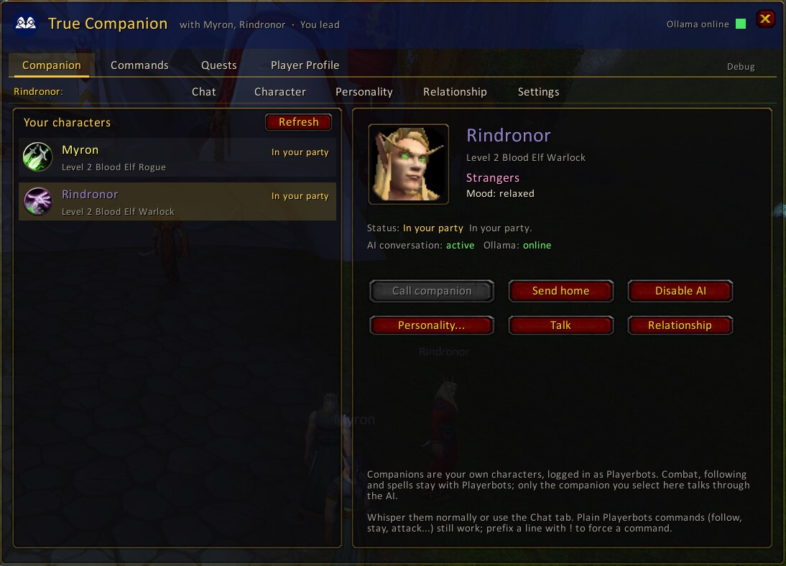
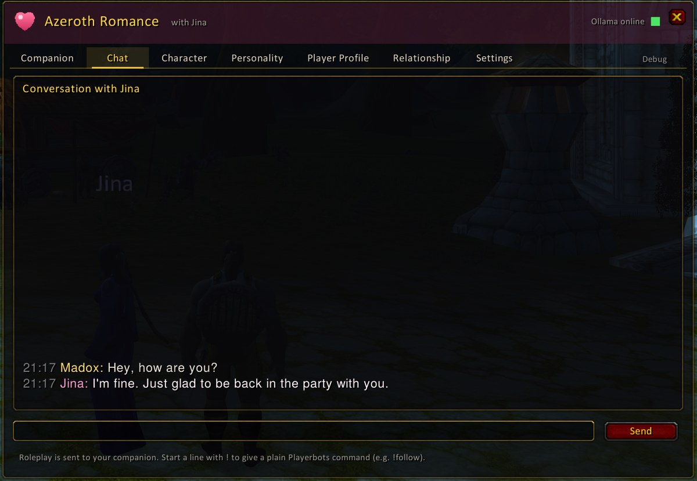
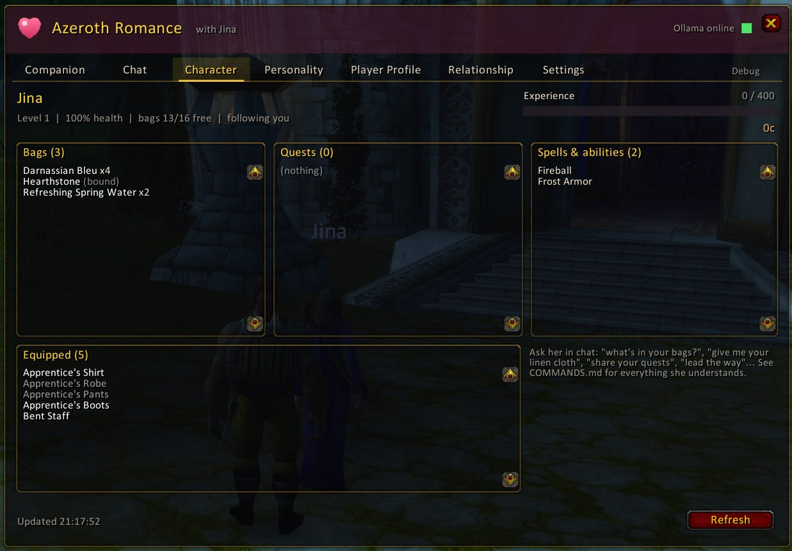
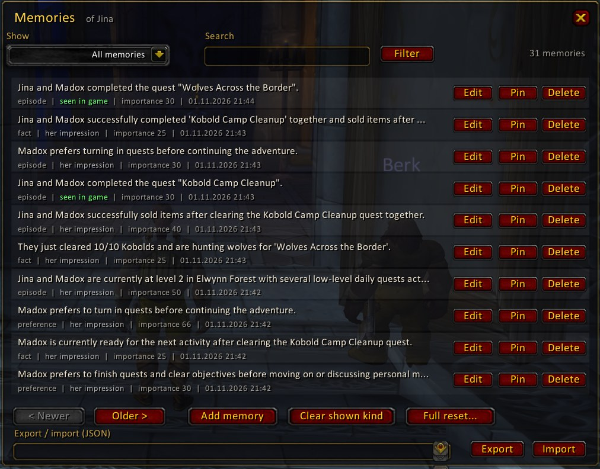

<p align="center"></p>

<h1 align="center">mod-true-companion</h1>

<p align="center"><i>Formerly <b>mod-romance</b>. Upgrading? See <a href="docs/INSTALLATION.md#upgrading-from-mod-romance">Upgrading from mod-romance</a>.</i></p>

**Author:** [davidlovcov](https://github.com/davidlovcov)

An AI companion and relationship module for **AzerothCore (WotLK 3.3.5a)** with **mod-playerbots** and a local **Ollama** model.

Turn one of your own characters into a companion who remembers you. Your companion keeps the personality you configured, reacts to fights, level-ups and gifts, sometimes starts conversations, and the relationship between you grows over time. Male and female companions work the same way. Combat, movement and spellcasting stay with the normal Playerbots AI. Ollama only supplies the conversation, and **only for the companion you explicitly select**, never for your other bots.

The in-game interface is the companion addon: **[azerothcore-true-companion-addon](https://github.com/davidlovcov/azerothcore-true-companion-addon)**.

## Screenshots

| Companion | Chat | Character |
|---|---|---|
|  |  |  |

A companion's memory after a short questing session (editable in the addon):



More screenshots in the [addon repository](https://github.com/davidlovcov/azerothcore-true-companion-addon#screenshots).

## Features

| Area | Summary |
|---|---|
| Companions | Your account's characters (plus Playerbots linked accounts) with their real status. Up to 3 AI companions at once (configurable). They are called through `PlayerbotHolder::AddPlayerBot`, never twice, and only after an ownership check on the server. |
| Personality | Identity, story, 12 traits, response styles (anime, sweet, mature, teasing, tsundere, dandere, fantasy roleplay...), custom instructions, EN/DE/auto language. 14 complete presets (7 female, 7 male, e.g. **Anime Girlfriend**, **Gentle Knight**), your own custom presets, and a randomizer for story & taste. Adults only (enforced). |
| Memory | Short-term history plus long-term facts, preferences, episodes, gifts, promises, milestones and summaries. Each entry is tagged with its source; entries are de-duplicated, ranked by relevance and pruned within limits. They can be edited, deleted, exported and imported in the addon. |
| Relationship | Friendship, affection, attraction, trust, familiarity, comfort and satisfaction, plus mood. Eight stages from Strangers to Married, with a selectable starting stage. Progress is gradual and capped per day. Dating, engagement and marriage need an accepted proposal, which the server decides. |
| Gifts | Detected only after a **completed** trade, with the item confirmed in the companion's bags. The score weighs usefulness, upgrades, class fit, rarity, likes and dislikes, and romance (jewelry and rings count extra). Repeats count for less, there is a daily cap, and the same item instance is never rewarded twice. |
| World awareness | Zone, party, health, fights and near-death moments, deaths, level-ups, quests and notable loot. Only events the server observed are given to the model. |
| Initiative | Proactive lines with cooldowns, an hourly cap and a back-off when you don't reply; companions stay quiet during combat. |
| Game knowledge | Ask about your companion's bags, gold, XP, gear, spells, quests (with progress, and which you share) or your target. The answer comes from real game data. |
| Commands | Plain sentences: follow, stay, give items or gold (your companion opens the trade), cast a spell on you or your target, attack an enemy by name or creature type, sell junk at a vendor, share quests, and (experimental) lead the way to a quest. Playerbots commands pass through untouched (`follow`, `co +dps`, `!stay`). See [docs/COMMANDS.md](docs/COMMANDS.md). |
| Estrangement | Treat your companion badly again and again and they leave you: they refuse your calls for days and come back cold. Winning them back takes sincere apologies over several days. |
| Safety | Ollama requests run on a bounded worker pool with timeouts and cancellation, never on the world thread. The server keeps running when Ollama is down. The addon protocol is rate- and size-limited. Model output is sanitized and validated. |

## Presets

A preset is a complete personality: traits, response style, age, gender, pronouns, every story field and custom instructions.

- **Apply preset** replaces all of these. Your companion's name and nickname stay, and so do the reply language, custom stage labels and the "always says yes" setting.
- **Reset to preset** applies the companion's current preset again, so every field goes back to the preset's values.
- **Undo changes** throws away edits you haven't saved yet.
- **Save as preset** stores the current personality as your own preset (per account, without the name). You can apply it to any companion, overwrite it by saving under the same name, or delete it.
- The list shows presets for your companion's gender. Tick "All genders" to see every preset.
- **Randomize** (Story & taste) fills the story fields with a random background. Nothing is saved until you press Save. The Player Profile tab has the same button for your own story.

## Requirements

- [mod-playerbots/azerothcore-wotlk](https://github.com/mod-playerbots/azerothcore-wotlk) (branch `Playerbot`) and [mod-playerbots](https://github.com/mod-playerbots/mod-playerbots)
- [Ollama](https://ollama.com) with `qwen3.5:4b` (fallback `qwen3:4b-instruct`), on the same machine or reachable over the network
- `AddonChannel = 1` in worldserver.conf (the default)

## Installation

```bash
cd azerothcore-wotlk/modules
git clone https://github.com/davidlovcov/mod-true-companion.git
cd .. && ./acore.sh compiler build        # or your usual CMake build
```
Then copy `mod_true_companion.conf.dist` to `mod_true_companion.conf` in your `etc/modules` folder and set `TrueCompanion.Ollama.Url`.

**Updating:** run `cd modules/mod-true-companion && git pull`, then rebuild.

See [docs/INSTALLATION.md](docs/INSTALLATION.md) for Linux and Windows 11 details and troubleshooting.

## Module integration

| | |
|---|---|
| Tested core | mod-playerbots/azerothcore-wotlk `93333d6`, mod-playerbots `05a1f6f` |
| Configuration | `conf/mod_true_companion.conf.dist`, copied automatically by CMake. See [docs/CONFIGURATION.md](docs/CONFIGURATION.md). |
| SQL | characters database, 7 `true_companion_*` tables, applied automatically by the DB updater (`data/sql/db-characters/base`) |
| CMake hooks | `mod-true-companion.cmake` (links `ws2_32` on Windows, Threads) |
| WorldScript | `OnAfterConfigLoad`, `OnStartup`, `OnShutdown`, `OnUpdate` |
| PlayerScript | `OnPlayerCanUseChat` (whisper, group), `OnPlayerLogin`, `OnPlayerLogout`, `OnPlayerCreatureKill`, `OnPlayerCompleteQuest`, `OnPlayerStoreNewItem` |
| ServerScript | `CanPacketReceive` (`CMSG_ACCEPT_TRADE`), `CanPacketSend` (`SMSG_TRADE_STATUS`) |
| CommandScript | `.companion status \| summon \| dismiss \| on \| off` |
| Core changes | none |

## Documentation

- [docs/COMMANDS.md](docs/COMMANDS.md): everything you can say to your companion
- [docs/INSTALLATION.md](docs/INSTALLATION.md)
- [docs/CONFIGURATION.md](docs/CONFIGURATION.md)
- [docs/ARCHITECTURE.md](docs/ARCHITECTURE.md)
- [docs/ADDON_PROTOCOL.md](docs/ADDON_PROTOCOL.md)
- [docs/TESTING.md](docs/TESTING.md)
- [CHANGELOG.md](CHANGELOG.md)

## Tests

```bash
scripts/run-tests.sh          # C++ unit, network and integration tests (no server build needed)
scripts/run-tests.sh --sql    # + SQL test against a local MySQL/MariaDB
```

## Project status

All automated tests pass. **In-game testing is still in progress.** Please report problems as GitHub issues and include your worldserver log.

## License

GPL-2.0-or-later, see [LICENSE](LICENSE). Built for AzerothCore (GPL-2.0) and mod-playerbots (GPL-2.0-or-later); talks to Ollama over its HTTP API. No third-party code is bundled. Language models are downloaded separately; check each model's license.

World of Warcraft® is a trademark of Blizzard Entertainment, Inc. This project isn't affiliated with or endorsed by Blizzard.
